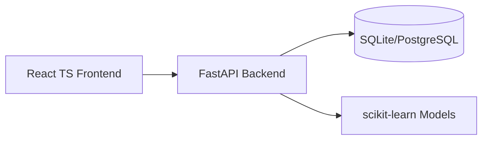

# AI-Powered Electronics Rental and Revenue Intelligence

[](https://react.dev/)
[](https://www.typescriptlang.org/)
[](https://fastapi.tiangolo.com/)
[](https://www.python.org/)
[](LICENSE)

## Tagline
Smart electronics rental platform with ML-driven demand forecasting, dynamic pricing, and revenue intelligence.

## Introduction
Full-stack application combining a React/TypeScript frontend with a FastAPI backend, SQLite/PostgreSQL persistence, JWT auth, and scikit-learn models.

## Problem Statement
Electronics are expensive and underutilized; rentals democratize access while ML optimizes pricing and inventory.

## Objectives
- Enable secure rental bookings
- Provide admin analytics
- Forecast demand and recommend pricing

## Key Features (Implemented)
- User registration/login (bcrypt + JWT)
- Product catalog & rentals
- Admin dashboard metrics
- Demand forecasting (heuristic/ML)
- Dynamic pricing recommendations
- Customer segmentation (KMeans if trained)

## Partially Implemented
- ML training endpoints depend on data volume
- PostgreSQL connectivity configured via environment (SQLite default)

## Planned
- Real payment gateway
- Docker compose

## Architecture


## Tech Stack
Frontend: React, TypeScript, Vite, Tailwind, Recharts
Backend: FastAPI, Python, SQLAlchemy-style DB layer
ML: scikit-learn, joblib
Auth: JWT + bcrypt

## Folder Structure
```
src/ frontend
backend/ API, DB, ML, security
```

## Installation (Windows)
```powershell
npm install
cd backend
pip install -r requirements.txt
python init_db.py
```

## Run
```powershell
npm run dev
cd backend; python main.py
```

## API Examples
POST /api/auth/login
```json
{"access_token":"...","token_type":"bearer"}
```

## Security
- Password hashing, JWT, CORS

## Limitations
- SQLite default; ML metrics from reports not independently verified

## License
MIT
```

## Author
Samala Rakshith Babu